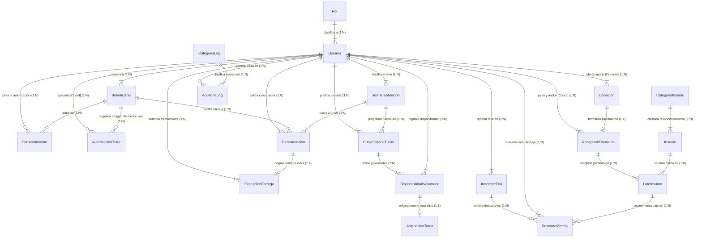

# Modelo Entidad-Relación (MER) — SIG-CCPT

## Sistema de Información y Gestión para el Comedor Comunitario Pan para Todos

Este documento estructura el diseño y construcción formal del Modelo Entidad-Relación (MER) del sistema conforme a la hoja de ruta establecida en el proyecto, incorporando las **20 entidades normalizadas en Tercera Forma Normal (3FN)**: autorización del tutor legal para la imagen de menores con historial auditable (`AutorizacionTutor`), ciclo de servicio con tope de raciones (`JornadaAtencion`), flujo en dos fases de voluntariado (`DisponibilidadVoluntario` y `AsignacionTarea`), recepción física formal de donaciones (`RecepcionDonacion`) y catálogo taxonómico de auditoría (`CategoriaLog`).

---

## 1. Lista de Entidades y Propósito en el Sistema

### Módulo 1: Seguridad, Usuarios y Roles (RBAC)

1. **`Rol`**  

   * **Propósito:** Define los perfiles de acceso y permisos dentro del sistema (Coordinadora, Presidente JAC, Voluntario, Donante), garantizando el principio de menor privilegio y la separación de funciones operativas y administrativas ([RF-04](RF.md)).

2. **`Usuario`**  

   * **Propósito:** Representa a las personas autorizadas para interactuar con el sistema (voluntarios con acceso ágil vía PIN, coordinadora, donantes y presidente de JAC con credenciales institucionales), controlando su estado de activación y trazabilidad de sus acciones ([RF-04](RF.md), [RF-25](RF.md)).

---

### Módulo 2: Beneficiarios, Habeas Data, Jornadas y Control de Asistencia

3. **`Beneficiario`**  

   * **Propósito:** Modela a los comensales del comedor comunitario en un padrón único centralizado para eliminar duplicidades entre registros de reja y coordinación. Almacena datos según niveles de sensibilidad, contemplando procedencia barrial opcional y condición de menor de edad ([RF-01](RF.md), [RF-02](RF.md), [RF-21](RF.md), [RF-24](RF.md)).

4. **`Consentimiento`**  

   * **Propósito:** Registra cada autorización que el beneficiario da sobre sus datos (Ley 1581, Habeas Data): qué versión de la política aceptó, para qué finalidad, cuándo y qué usuario la tomó. La autorización es verbal (el Decreto 1377 de 2013 admite la autorización oral) y la prueba es este registro. Cubre el consentimiento informado y, como finalidades propuestas, el reporte a la Alcaldía y el uso de imagen ([RF-18](RF.md), [RF-19](RF.md), [RF-20](RF.md)).

5. **`AutorizacionTutor`**  

   * **Propósito:** Registra la autorización expresa y firmada del padre, la madre, el acudiente o el tutor legal para el uso de la imagen de un beneficiario menor de edad. Guarda los datos de identificación y contacto del tutor, el parentesco, el soporte firmado y la Coordinadora que la aprobó. Conserva el historial completo (autorizaciones activas y revocadas) para auditoría, y solo puede existir una autorización `ACTIVA` por beneficiario ([RF-21](RF.md), RNF-09, RNF-12).

6. **`JornadaAtencion`**  

   * **Propósito:** Modela el ciclo de servicio diario del comedor comunitario, estableciendo la fecha, capacidad máxima de raciones preparadas/financiadas para el día, raciones servidas en tiempo real, horarios de apertura/cierre y estados operativos (`PROGRAMADA`, `EN_CURSO`, `CERRADA_AGOTADA`, `FINALIZADA`). Impide la emisión indiscriminada o infinita de turnos en reja ([RF-03](RF.md), [RF-07](RF.md)).

7. **`TurnoAtencion`**  

   * **Propósito:** Controla el flujo operativo diario en la fila mediante la emisión de turnos consecutivos indexados a la jornada activa, registrando la hora de llegada, el estado de atención y garantizando el control de no duplicidad de raciones por comensal en el mismo servicio ([RF-03](RF.md)).

8. **`ExcepcionEntrega`**  

   * **Propósito:** Registra y justifica las entregas extraordinarias de alimentos (por ejemplo: ración adicional para familiar postrado o mercado para llevar), vinculando obligatoriamente al usuario responsable que autorizó el caso ([RF-07](RF.md)).

---

### Módulo 3: Cadena de Suministro, Donaciones e Inventario FEFO

9. **`CategoriaInsumo`**  

   * **Propósito:** Catálogo taxonómico que clasifica las familias de alimentos (Cárnicos, Granos, Lácteos, Abarrotes, etc.) y parametriza las reglas bromatológicas del sistema: exigencia obligatoria de cadena de frío y días de anticipación para el semáforo de alertas preventivas FEFO ([RF-08](RF.md), [RF-09](RF.md), [RF-10](RF.md)).

10. **`Insumo`**  

   * **Propósito:** Catálogo maestro de materias primas y víveres gestionados por el comedor (ej: Arroz blanco, Pechuga de pollo, Aceite vegetal). Estandariza el nombre, la unidad de medida (kg, litros, unidades) y la categoría a la que pertenece, evitando duplicidades ortográficas y permitiendo consolidar el stock total de la cocina ([RF-08](RF.md), [RF-11](RF.md)).

11. **`Donacion`**  

    * **Propósito:** Modela la manifestación de intención y oferta del cargamento por parte del donante, registrando peso estimado, fecha y estado de aprobación previa por parte de Coordinación ([RF-11](RF.md), [RF-12](RF.md)).

12. **`RecepcionDonacion`**  

    * **Propósito:** Formaliza el ingreso físico del cargamento a las instalaciones de la cocina comunitaria: registra pesaje final en báscula, soporte fotográfico obligatorio de bultos/cajas sin rostros, acta inmutable y emisión del certificado digital con hash ([RF-11](RF.md), [RF-12](RF.md)).

13. **`LoteInsumo`**  

    * **Propósito:** Representa la partida física real ingresada al almacén vinculada a un insumo del catálogo y a una recepción formal. Controla existencias disponibles, fechas de caducidad para rotación FEFO (*First Expired, First Out*) y ubicación en estantería o frío ([RF-08](RF.md), [RF-09](RF.md)).

---

### Módulo 4: Control de Calidad, Mermas y Cadena de Frío

14. **`IncidenteFrio`**  

    * **Propósito:** Registra fallas técnicas o cortes de energía en equipos de refrigeración/congelación, permitiendo evaluar el impacto bromatológico sobre los lotes conservados y justificar decisiones de descarte ([RF-10](RF.md)).

15. **`DescarteMerma`**  

    * **Propósito:** Registra las actas formales de baja de alimentos no aptos para consumo, vinculadas al lote físico específico, documentando kilos descartados, motivo técnico, soporte fotográfico del pesaje/acta y la aprobación obligatoria de la Coordinadora ([RF-05](RF.md), [RF-06](RF.md)).

---

### Módulo 5: Gestión de Voluntariado Comunitario y Operación

16. **`ConvocatoriaTurno`**  

    * **Propósito:** Gestiona las jornadas operativas programadas por la coordinación (fecha, franja horaria y cupos requeridos) donde los voluntarios postulan su disponibilidad ([RF-13](RF.md)).

17. **`DisponibilidadVoluntario`**  

    * **Propósito:** Modela la manifestación explícita de disponibilidad o postulación de un usuario voluntario a una jornada operativa específica, controlando estado (`POSTULADO`, `SELECCIONADO`, `CANCELADO`) y evitando saltos de flujo sin validación previa de cupo ([RF-13](RF.md), [RF-14](RF.md)).

18. **`AsignacionTarea`**  

    * **Propósito:** Asigna de forma individual y unívoca (1:1) una estación de trabajo concreta (Reja, Cocina, Salón, Lavado) a un voluntario cuya disponibilidad ha sido formalizada, registrando inducción interactiva y asistencia física ([RF-14](RF.md), [RF-15](RF.md)).

---

### Módulo 6: Gobernanza, Auditoría Forense y Cumplimiento Legal

19. **`CategoriaLog`**  

    * **Propósito:** Catálogo taxonómico que clasifica los eventos del sistema por severidad (`INFO`, `ALERTA`, `CRITICO`) y ámbito operativo, facilitando filtros de veeduría y directrices de retención ([RF-16](RF.md), [RF-22](RF.md)).

20. **`AuditoriaLog`**  

    * **Propósito:** Registro inmutable de eventos críticos del sistema (autorizaciones de mermas, exportación de bases de datos para convenios institucionales, cambios de privilegios y purgas por políticas de retención TTL) para garantizar veeduría comunitaria y cumplimiento legal ([RF-16](RF.md), [RF-18](RF.md), [RF-22](RF.md)).

---

## 2. Justificación y Definición de Relaciones entre Entidades

### 2.1. Matriz de Relaciones Directas Aprobadas (28 Relaciones)

A continuación se detalla cada relación del modelo, justificando el **por qué sí se relacionan**, con su interpretación literal de negocio y su especificación técnica formal de cardinalidad:

| Entidad Origen | Entidad Destino | ¿Por qué sí se relacionan? | Descripción Literal (Negocio) | Descripción Técnica & Cardinalidad |

| :--- | :--- | :--- | :--- | :--- |

| **`Rol`** | **`Usuario`** | Garantiza el control de acceso basado en roles (RBAC). Cada usuario debe operar bajo un conjunto delimitado de permisos ([RF-04](RF.md)). | Un rol clasifica y otorga facultades a múltiples usuarios del comedor; cada usuario pertenece obligatoriamente a un único rol activo en el sistema. | **1 a N** (`1:N`) • `Rol` (1,1) a `Usuario` (0,N) • FK en `Usuario`: `rol_id` (NOT NULL). |

| **`Usuario`** | **`Beneficiario`** | Auditoría y responsabilidad del empadronamiento inicial. Se debe conocer quién registró formalmente a la persona comensal ([RF-01](RF.md), [RF-02](RF.md)). | Un voluntario de reja o la coordinadora registra a numerosos beneficiarios a lo largo del tiempo; cada beneficiario consigna el usuario responsable de su alta. | **1 a N** (`1:N`) • `Usuario` (0,N) a `Beneficiario` (1,1) • FK en `Beneficiario`: `registrado_por_usuario_id` (NOT NULL). |

| **`Beneficiario`** | **`Consentimiento`** | Cumplimiento de la Ley 1581 (Habeas Data): cada autorización queda registrada con su versión de política y su finalidad ([RF-18](RF.md), [RF-19](RF.md), [RF-20](RF.md)). | Un beneficiario puede dar varias autorizaciones a lo largo del tiempo (una por finalidad y, si la política cambia, una por versión); quien se registró antes de RF-19 puede no tener ninguna todavía. Cada autorización pertenece a un único beneficiario. | **1 a N** (`1:N`) • `Beneficiario` (1,1) a `Consentimiento` (0,N) • FK en `Consentimiento`: `beneficiario_id` (NOT NULL). • `UNIQUE (beneficiario_id, finalidad, version_politica)`: repetir la misma autorización no crea otro registro. |

| **`Usuario`** | **`Consentimiento`** | Trazabilidad de quién tomó la autorización verbal ([RF-19](RF.md), RNF-07, RNF-09). | El voluntario o la coordinadora que atiende a la persona registra su autorización; el servidor toma el usuario de la sesión, así que no se puede falsear desde la pantalla. | **1 a N** (`1:N`) • `Usuario` (0,N) a `Consentimiento` (1,1) • FK en `Consentimiento`: `registrado_por_usuario_id` (NOT NULL). |

| **`Beneficiario`** | **`AutorizacionTutor`** | Protección reforzada de la imagen de niños, niñas y adolescentes: ningún uso de imagen de un menor sin autorización expresa del tutor legal ([RF-21](RF.md), RNF-12). | Un beneficiario menor de edad puede acumular varias autorizaciones a lo largo del tiempo (cambio de acudiente, revocación y nueva firma), pero solo una puede estar vigente; cada autorización pertenece a un único beneficiario. | **1 a N** (`1:N`) • `Beneficiario` (1,1) a `AutorizacionTutor` (0,N) • FK en `AutorizacionTutor`: `beneficiario_id` (NOT NULL). Restricción `UNIQUE` sobre la columna generada `beneficiario_activo_id` para permitir una sola autorización `ACTIVA` por beneficiario. |

| **`Usuario`** | **`AutorizacionTutor`** | Aprobación exclusiva de la Coordinadora y trazabilidad de quién validó el soporte firmado ([RF-21](RF.md), RNF-07, RNF-09). | La coordinadora revisa el documento firmado y los datos del tutor y aprueba la autorización; cada autorización consigna obligatoriamente a la usuaria que la aprobó. | **1 a N** (`1:N`) • `Usuario` (0,N) a `AutorizacionTutor` (1,1) • FK en `AutorizacionTutor`: `aprobada_por_usuario_id` (NOT NULL). |

| **`Usuario`** | **`JornadaAtencion`** | Apertura, habilitación y cierre formal del servicio de comedor por la Coordinación ([RF-03](RF.md)). | La coordinadora programa la jornada, define el tope de raciones preparadas en cocina y autoriza la apertura física de la atención. | **1 a N** (`1:N`) • `Usuario` (0,N) a `JornadaAtencion` (1,1) • FK en `JornadaAtencion`: `abierta_por_usuario_id` (NOT NULL). |

| **`JornadaAtencion`** | **`TurnoAtencion`** | Indexación de turnos emitidos a la jornada activa y control de capacidad máxima de raciones ([RF-03](RF.md)). | Una jornada abierta emite múltiples turnos consecutivos en reja hasta alcanzar el tope de platos cocinados; cada turno emitido pertenece forzosamente a una jornada. | **1 a N** (`1:N`) • `JornadaAtencion` (1,1) a `TurnoAtencion` (0,N) • FK en `TurnoAtencion`: `jornada_id` (NOT NULL). |

| **`JornadaAtencion`** | **`ConvocatoriaTurno`** | Calendarización de convocatorias de voluntariado subordinadas a la jornada del día ([RF-13](RF.md)). | Una jornada de atención programa las convocatorias requeridas para cubrir sus franjas horarias (mañana, mediodía, tarde); cada convocatoria está ligada obligatoriamente a una jornada diaria. | **1 a N** (`1:N`) • `JornadaAtencion` (1,1) a `ConvocatoriaTurno` (0,N) • FK en `ConvocatoriaTurno`: `jornada_id` (NOT NULL). Restricción `UNIQUE(jornada_id, franja_horaria)`. |

| **`Beneficiario`** | **`TurnoAtencion`** | Control de fila, asignación de raciones y verificación de concurrencia ([RF-01](RF.md), [RF-03](RF.md)). | Un beneficiario recibe un tiquete de atención en la jornada en la que asiste al comedor; cada tiquete emitido pertenece de forma unívoca a un beneficiario. | **1 a N** (`1:N`) • `Beneficiario` (0,N) a `TurnoAtencion` (1,1) • FK en `TurnoAtencion`: `beneficiario_id` (NOT NULL). Restricción `UNIQUE(beneficiario_id, jornada_id)` para impedir doble turno en el mismo servicio. |

| **`Usuario`** | **`TurnoAtencion`** | Trazabilidad del operador de reja que emite el turno consecutivo e ingresa al comensal ([RF-03](RF.md)). | El voluntario asignado en la puerta genera y valida decenas de turnos durante la guardia; cada turno emitido lleva la firma digital de dicho voluntario. | **1 a N** (`1:N`) • `Usuario` (0,N) a `TurnoAtencion` (1,1) • FK en `TurnoAtencion`: `emitido_por_usuario_id` (NOT NULL). |

| **`TurnoAtencion`** | **`ExcepcionEntrega`** | Registro de entregas extraordinarias (segundo plato, mercado para llevar) directamente contextualizadas en la atención del día ([RF-07](RF.md)). | Durante un turno de atención puede concederse extraordinariamente una excepción justificada; cada excepción concedida está respaldada por el turno específico de esa jornada. | **1 a 0..1** (`1:1 opcional`) • `TurnoAtencion` (0,1) a `ExcepcionEntrega` (1,1) • FK en `ExcepcionEntrega`: `turno_id` (`UNIQUE`, NOT NULL). |

| **`Usuario`** | **`ExcepcionEntrega`** | Requisito normativo no ambiguo: la excepción debe estar expresamente autorizada por una persona con atribuciones ([RF-07](RF.md)). | La coordinadora o presidente comunal evalúa y autoriza las excepciones de entrega; cada excepción documenta obligatoriamente al usuario que asumió la autorización. | **1 a N** (`1:N`) • `Usuario` (0,N) a `ExcepcionEntrega` (1,1) • FK en `ExcepcionEntrega`: `autorizado_por_usuario_id` (NOT NULL). |

| **`CategoriaInsumo`** | **`Insumo`** | Clasificación taxonómica y parametrización de directrices bromatológicas (cadena de frío y semáforo FEFO) ([RF-08](RF.md), [RF-09](RF.md)). | Una categoría agrupa múltiples insumos de la misma naturaleza (ej: Cárnicos agrupa pollo, res, cerdo); cada insumo del catálogo pertenece a una única categoría. | **1 a N** (`1:N`) • `CategoriaInsumo` (1,1) a `Insumo` (0,N) • FK en `Insumo`: `categoria_id` (NOT NULL). |

| **`Usuario`** | **`Donacion`** *(Donante)* | Identificación del origen de la ayuda alimentaria aportada ([RF-11](RF.md), [RF-12](RF.md)). | Un donante ofrece cargamentos a través del portal; cada donación tiene como titular a un usuario registrado con rol de donante. | **1 a N** (`1:N`) • `Usuario` (0,N) a `Donacion` (1,1) • FK en `Donacion`: `donante_usuario_id` (NOT NULL). |

| **`Donacion`** | **`RecepcionDonacion`** | Formalización física de recepción en cocina y pesaje de báscula ([RF-11](RF.md)). | Una donación aceptada da lugar a un único acto físico de recepción e inspección en cocina con pesaje verificado y fotos. | **1 a 1** (`1:1`) • `Donacion` (1,1) a `RecepcionDonacion` (0,1) • FK en `RecepcionDonacion`: `donacion_id` (`UNIQUE`, NOT NULL). |

| **`Usuario`** | **`RecepcionDonacion`** | Trazabilidad de la persona que pesa y recibe físicamente el cargamento en cocina ([RF-11](RF.md)). | La coordinadora o auxiliar de cocina realiza la inspección física y pesaje; cada recepción consigna al usuario receptor. | **1 a N** (`1:N`) • `Usuario` (0,N) a `RecepcionDonacion` (1,1) • FK en `RecepcionDonacion`: `recibido_por_usuario_id` (NOT NULL). |

| **`RecepcionDonacion`** | **`LoteInsumo`** | Desglose del cargamento ingresado en partidas de alimentos clasificadas ([RF-08](RF.md), [RF-11](RF.md)). | Un cargamento recepcionado físicamente se desglosa en uno o varios lotes concretos en estantería; cada lote pertenece a una única recepción madre. | **1 a N** (`1:N`) • `RecepcionDonacion` (1,1) a `LoteInsumo` (1,N) • FK en `LoteInsumo`: `recepcion_id` (NOT NULL). |

| **`Insumo`** | **`LoteInsumo`** | Instanciación del producto abstracto en partidas físicas reales en despensa ([RF-08](RF.md), [RF-11](RF.md)). | Un insumo del catálogo se materializa en múltiples lotes recibidos a lo largo del tiempo; cada lote corresponde a un único insumo maestro. | **1 a N** (`1:N`) • `Insumo` (1,1) a `LoteInsumo` (0,N) • FK en `LoteInsumo`: `insumo_id` (NOT NULL). |

| **`LoteInsumo`** | **`DescarteMerma`** | Descargo formal de stock físico de alimentos caducados o deteriorados con trazabilidad FEFO ([RF-05](RF.md), [RF-06](RF.md)). | Un lote de alimentos puede experimentar mermas o descartes (parciales o totales); cada acta de merma descuenta kilos de un lote de inventario concreto. | **1 a N** (`1:N`) • `LoteInsumo` (0,N) a `DescarteMerma` (1,1) • FK en `DescarteMerma`: `lote_id` (NOT NULL). |

| **`Usuario`** | **`DescarteMerma`** | Aprobación vinculante y obligatoria de bajas para evitar desvíos o arbitrariedades ([RF-05](RF.md), [RF-06](RF.md)). | La coordinadora verifica el estado del alimento, la evidencia fotográfica y autoriza la baja; cada acta de merma exige la firma inmutable del usuario autorizador. | **1 a N** (`1:N`) • `Usuario` (0,N) a `DescarteMerma` (1,1) • FK en `DescarteMerma`: `autorizado_por_usuario_id` (NOT NULL). |

| **`IncidenteFrio`** | **`DescarteMerma`** | Respaldo probatorio ante auditorías en caso de pérdida por fallo técnico de congelador ([RF-06](RF.md), [RF-10](RF.md)). | Un fallo en la cadena de frío puede originar una o varias actas de descarte de los insumos descompuestos; un acta de descarte puede citar un incidente de frío o deberse a causas ordinarias de caducidad. | **1 a N opcional** (`0..1 a 0..N`) • `IncidenteFrio` (0,N) a `DescarteMerma` (0,1) • FK en `DescarteMerma`: `incidente_frio_id` (NULL si la baja es por fecha de vencimiento ordinaria). |

| **`Usuario`** | **`IncidenteFrio`** | Reporte inmediato de averías o descongelamientos por parte del equipo en cocina ([RF-10](RF.md)). | Un voluntario u operador de cocina registra la novedad de la nevera/congelador; cada reporte de incidente identifica al usuario que levantó la alerta. | **1 a N** (`1:N`) • `Usuario` (0,N) a `IncidenteFrio` (1,1) • FK en `IncidenteFrio`: `reportado_por_usuario_id` (NOT NULL). |

| **`Usuario`** | **`ConvocatoriaTurno`** | Creación y coordinación de jornadas de voluntariado ([RF-13](RF.md)). | La coordinadora publica las convocatorias semanales fijando turnos y franjas horarias; cada convocatoria es creada por un usuario administrativo. | **1 a N** (`1:N`) • `Usuario` (0,N) a `ConvocatoriaTurno` (1,1) • FK en `ConvocatoriaTurno`: `creado_por_usuario_id` (NOT NULL). |

| **`Usuario`** | **`DisponibilidadVoluntario`** | Postulación explícita de disponibilidad por parte del voluntario ([RF-13](RF.md), [RF-14](RF.md)). | Un voluntario manifiesta su intención de servir registrando su disponibilidad en una o varias convocatorias; cada registro pertenece a un voluntario concreto. | **1 a N** (`1:N`) • `Usuario` (0,N) a `DisponibilidadVoluntario` (1,1) • FK en `DisponibilidadVoluntario`: `voluntario_usuario_id` (NOT NULL). |

| **`ConvocatoriaTurno`** | **`DisponibilidadVoluntario`** | Recepción y agregación de postulantes para cubrir los cupos de la jornada ([RF-13](RF.md)). | Una convocatoria recibe las postulaciones de múltiples voluntarios interesados; cada postulación se suscribe a una jornada específica. | **1 a N** (`1:N`) • `ConvocatoriaTurno` (1,1) a `DisponibilidadVoluntario` (0,N) • FK en `DisponibilidadVoluntario`: `convocatoria_id` (NOT NULL). Restricción `UNIQUE(convocatoria_id, voluntario_usuario_id)`. |

| **`DisponibilidadVoluntario`** | **`AsignacionTarea`** | Asignación efectiva de puesto y estación a un voluntario previamente postulado ([RF-14](RF.md), [RF-15](RF.md)). | Una vez confirmada la postulación, se le adjudica de forma exclusiva un puesto en la estación de trabajo asignada; la asignación es indivisible y 1:1 con la disponibilidad. | **1 a 1** (`1:1`) • `DisponibilidadVoluntario` (1,1) a `AsignacionTarea` (0,1) • FK en `AsignacionTarea`: `disponibilidad_id` (`UNIQUE`, NOT NULL). |

| **`CategoriaLog`** | **`AuditoriaLog`** | Clasificación sistemática de eventos por gravedad y ámbito normativo ([RF-16](RF.md), [RF-22](RF.md)). | Una categoría de log clasifica múltiples eventos históricos registrados; cada log de auditoría se indexa bajo una categoría maestra. | **1 a N** (`1:N`) • `CategoriaLog` (1,1) a `AuditoriaLog` (0,N) • FK en `AuditoriaLog`: `categoria_log_id` (NOT NULL). |

| **`Usuario`** | **`AuditoriaLog`** | Trazabilidad de la persona que ejecutó la operación sensible ([RF-16](RF.md), [RF-18](RF.md)). | Un usuario genera múltiples registros en la bitácora cuando ejecuta acciones sensibles; cada log registra al usuario actuante (o nulo en procesos del sistema). | **1 a N opcional** (`0..1 a 0..N`) • `Usuario` (0,N) a `AuditoriaLog` (0,1) • FK en `AuditoriaLog`: `usuario_id` (NULL si es proceso automático del sistema). |

---

### 2.2. Análisis y Resolución de Relaciones con Aparente Circularidad

En el diseño del modelo aparecen estructuras que superficialmente podrían asemejarse a referencias circulares (bucles cerrados de llaves foráneas). A continuación se justifica por qué **no constituyen ciclos ambiguos ni redundantes**, o cómo se resolvió la estructura para garantizar máxima claridad relacional:

#### Caso 1: Ciclo de Servicio y Emisión de Turnos (`Usuario` ➔ `JornadaAtencion` ➔ `TurnoAtencion` ➔ `Usuario`)

* **Dilema Resuelto:** Se planteó la duda de si los turnos de atención se podían emitir de forma infinita o desvinculada de la operación de cocina.

* **Resolución Técnica Adoptada:** Se incorporó la entidad `JornadaAtencion`, que formaliza la jornada diaria:

  1. La Coordinadora (`Usuario`) abre la jornada (`abierta_por_usuario_id`) e ingresa la `capacidad_raciones` (ej: 150 raciones preparadas según minuta).

  2. El voluntario en reja (`Usuario`) solo puede emitir turnos (`TurnoAtencion`) si la jornada está en estado `'EN_CURSO'`, y el sistema valida que el número correlativo no exceda la capacidad máxima diaria.

  3. No existe ciclo ambiguo: el usuario que abre la jornada actúa como administrador general, mientras que el usuario emisor del turno actúa como operador táctil en la puerta.

#### Caso 2: Flujo de Voluntariado en Dos Fases (`Usuario` ➔ `ConvocatoriaTurno` ➔ `DisponibilidadVoluntario` ➔ `AsignacionTarea`)

* **Dilema Resuelto:** Si un voluntario se asignaba directamente a una tarea con clave foránea a `Usuario` y a `ConvocatoriaTurno`, parecía que se saltaba la postulación a la jornada y no se conocía la disponibilidad previa.

* **Resolución Técnica Adoptada:** Se divide el flujo en dos fases:

  1. **Fase 1 (Apertura y Disponibilidad):** La Coordinadora publica la `ConvocatoriaTurno` ($1:N$). El Voluntario postula su horario registrando un registro en `DisponibilidadVoluntario` ($1:N$ desde `Usuario` y $1:N$ desde `ConvocatoriaTurno`).

  2. **Fase 2 (Asignación Operativa):** Tras evaluar las postulaciones, la coordinación asigna el puesto físico (`estacion_trabajo`) a través de `AsignacionTarea`, la cual posee una relación **$1:1$ estricta** con `DisponibilidadVoluntario` (`disponibilidad_id UNIQUE`).

#### Caso 3: Separación de Oferta y Recepción de Donaciones (`Usuario` ➔ `Donacion` ➔ `RecepcionDonacion`)

* **Dilema Resuelto:** Se eliminó la doble FK a `Usuario` en `Donacion`. `Donacion` modela la oferta previa radicada por el donante; `RecepcionDonacion` modela el acto físico en cocina donde la Coordinadora pesa en báscula y toma la foto obligatoria sin rostros (relación $1:1$ con `Donacion`).

#### Caso 4: `Beneficiario` ➔ `TurnoAtencion` ➔ `ExcepcionEntrega` ➔ `Beneficiario` (Ciclo Evitado)

* **Resolución:** Se prohíbe la clave directa `beneficiario_id` en `ExcepcionEntrega`. La entrega extraordinaria se concede exclusivamente en el marco de un `TurnoAtencion` diario (`turno_id UNIQUE`), navegando al beneficiario de forma transitiva y segura:

  $$\text{ExcepcionEntrega} \longrightarrow \text{TurnoAtencion} \longrightarrow \text{Beneficiario}$$

---

### 2.3. Relaciones Excluidas o Prohibidas por Diseño (¿Por qué NO se relacionan?)

1. **`Beneficiario` NO se relaciona con `Donacion` ni con `LoteInsumo`:**

   * **Fundamento Normativo y Ético ([RF-17](RF.md), [RNF-07](file:///c:/Users/NeiderGM/OneDrive/Documentos/Sistemas%20ITP/6to%20semestre/02-%20METODOLOGIA%20DS/C2/RNF.md#L45-L48)):** Está terminantemente vetado vincular qué alimento o donación consumió una persona vulnerable. El inventario se controla a nivel de balance global de cocina; cruzar individualmente al comensal con la marca o donante violaría el derecho a la intimidad y generaría estigmatización.

2. **`Beneficiario` NO condiciona su atención a `Barrio` / Procedencia comunal:**

   * **Fundamento Comunal ([RF-24](RF.md)):** La procedencia barrial es un dato demográfico referencial y no una restricción excluyente.

3. **`Consentimiento` NO se vincula con `Donacion`:**

   * Protege exclusivamente a los comensales vulnerables del padrón comunitario bajo la Ley 1581. Sí guarda el `Usuario` que tomó la autorización, solo para trazabilidad (RNF-09).

---

## 3. Diagrama Relacional de Entidades (Solo Entidades, Cardinalidad y Verbos de Acción)

El diagrama formal editable para Draw.io / Diagrams.net se encuentra disponible en:  

📁 **[DIAGRAMA_MER.drawio](file:///c:/Users/NeiderGM/OneDrive/Documentos/Sistemas%20ITP/6to%20semestre/02-%20METODOLOGIA%20DS/C2/DIAGRAMA_MER.drawio)**  

📁 **[DIAGRAMA_MER_CON_ATRIBUTOS.drawio](file:///c:/Users/NeiderGM/OneDrive/Documentos/Sistemas%20ITP/6to%20semestre/02-%20METODOLOGIA%20DS/C2/DIAGRAMA_MER_CON_ATRIBUTOS.drawio)**

---

## 4. Definición de Atributos, Restricciones y Métodos por Entidad

A continuación se especifica la estructura detallada de cada una de las 20 entidades que componen el Modelo Entidad-Relación:

> **Tipos de los identificadores.** `Rol` (`INT` autoincremental), `Usuario` y `Beneficiario` (`UUID`) usan el tipo que ya tienen en el backend. En las demás entidades el tipo de `id` aparece como `ID` porque todavía no está definido: puede ser `INT` autoincremental o `UUID`, y se decide al implementar cada entidad. Una llave foránea siempre usa el mismo tipo que la llave a la que apunta.

---

### Módulo 1: Seguridad, Usuarios y Roles (RBAC)

#### 1. `Rol`

* **Descripción:** Catálogo maestro de perfiles del sistema para control de acceso basado en roles ([RF-04](RF.md)).

* **Atributos:**

  | Atributo | Tipo de Dato | Restricciones | Descripción / Justificación |

  | :--- | :--- | :--- | :--- |

  | `id` | `INT` | `PK, AUTO_INCREMENT` | Identificador único del rol. |

  | `nombre` | `VARCHAR(50)` | `NOT NULL, UNIQUE` | Nombre: `Coordinadora`, `Presidente JAC`, `Voluntario`, `Donante`. |

  | `descripcion` | `VARCHAR(255)` | `NULL` | Alcance y funciones del perfil. |

  | `nivel_acceso` | `INT` | `NOT NULL` | Nivel jerárquico (1=Operativo reja/cocina, 2=Veeduría/Donante, 3=Administrador). |

  | `creado_en` | `TIMESTAMP` | `DEFAULT CURRENT_TIMESTAMP` | Marca temporal de auditoría de creación. |

* **Métodos / Operaciones de Dominio:**

  * `asignarPermiso(modulo: String, accion: String): Void`: Asocia permisos específicos a la matriz de privilegios.

  * `validarPrivilegio(accion: String): Boolean`: Verifica si el rol cuenta con facultades para ejecutar una acción sensible.

---

#### 2. `Usuario`

* **Descripción:** Personas habilitadas para operar el sistema con credenciales diferenciadas por rol ([RF-04](RF.md), [RF-25](RF.md)).

* **Atributos:**

  | Atributo | Tipo de Dato | Restricciones | Descripción / Justificación |

  | :--- | :--- | :--- | :--- |

  | `id` | `UUID` | `PK, generado (uuid)` | Identificador único del usuario. |

  | `rol_id` | `INT` | `FK, NOT NULL` | Referencia al rol asignado (`Rol.id`). |

  | `nombre_completo` | `VARCHAR(150)` | `NOT NULL` | Nombre y apellido del usuario. |

  | `correo` | `VARCHAR(120)` | `UNIQUE, NULL` | Correo institucional (obligatorio para Coordinación, Donantes y JAC). |

  | `telefono` | `VARCHAR(20)` | `NOT NULL` | Teléfono de contacto / WhatsApp operativo. |

  | `pin_hash` | `VARCHAR(255)` | `NULL` | Hash del PIN de 4 dígitos para login rápido en pantalla táctil de reja. |

  | `password_hash` | `VARCHAR(255)` | `NULL` | Hash de contraseña para acceso institucional. |

  | `tipo_acceso` | `ENUM` | `NOT NULL, DEFAULT 'PIN'` | Tipo de credencial principal (`'PIN'`, `'PASSWORD'`). |

  | `activo` | `BOOLEAN` | `NOT NULL, DEFAULT TRUE` | Estado lógico para soft-delete (conserva integridad de auditoría histórica). |

  | `ultimo_acceso` | `TIMESTAMP` | `NULL` | Fecha y hora del último inicio de sesión. |

  | `creado_en` | `TIMESTAMP` | `DEFAULT CURRENT_TIMESTAMP` | Fecha de creación del registro. |

  | `actualizado_en` | `TIMESTAMP` | `DEFAULT CURRENT_TIMESTAMP ON UPDATE CURRENT_TIMESTAMP` | Fecha de última modificación. |

* **Métodos / Operaciones de Dominio:**

  * `autenticarPorPin(pin: String): Boolean`: Valida credencial táctil rápida para voluntarios en reja.

  * `autenticarPorPassword(password: String): Boolean`: Valida credencial institucional de administración/donantes.

  * `inactivarCuenta(motivo: String, admin_id: Int): Void`: Ejecuta baja lógica sin romper trazabilidad histórica.

  * `cambiarRol(nuevo_rol_id: Int): Void`: Actualiza perfil con registro automático en auditoría.

---

### Módulo 2: Padrón de Beneficiarios, Habeas Data, Jornadas y Control de Asistencia

#### 3. `Beneficiario`

* **Descripción:** Registro único centralizado de personas que acuden al comedor comunitario ([RF-01](RF.md), [RF-02](RF.md), [RF-21](RF.md), [RF-24](RF.md)).

* **Atributos:**

  | Atributo | Tipo de Dato | Restricciones | Descripción / Justificación |

  | :--- | :--- | :--- | :--- |

  | `id` | `UUID` | `PK, generado (uuid)` | Identificador único del comensal. |

  | `registrado_por_usuario_id` | `UUID` | `FK, NOT NULL` | Usuario que realizó el alta inicial en reja o coordinación. |

  | `codigo_comensal` | `VARCHAR(20)` | `NOT NULL, UNIQUE` | Código corto alfanumérico para agilizar búsqueda en fila (ej: `BEN-1042`). |

  | `nombres` | `VARCHAR(100)` | `NOT NULL` | Nombres del beneficiario. |

  | `apellidos` | `VARCHAR(100)` | `NOT NULL` | Apellidos del beneficiario. |

  | `tipo_documento` | `ENUM` | `NOT NULL, DEFAULT 'CC'` | Tipos válidos: `'CC'`, `'TI'`, `'RC'`, `'CE'`, `'PPT'`, `'SIN_DOCUMENTO'`. |

  | `numero_documento` | `VARCHAR(30)` | `NULL` | Cédula/Identificación (nullable para casos humanitarios sin documentos). |

  | `fecha_nacimiento` | `DATE` | `NULL` | Fecha de nacimiento para control bromatológico y cálculo etario. |

  | `es_menor_edad` | `BOOLEAN` | `NOT NULL, DEFAULT FALSE` | Bandera de protección de infancia (bloquea fotos y activa reglas tutelares). |

  | `barrio_procedencia` | `VARCHAR(100)` | `NULL` | Procedencia referencial comunal (no excluyente según RF-24). |

  | `telefono_contacto` | `VARCHAR(20)` | `NULL` | Teléfono referencial de contacto o acudiente. |

  | `hash_deduplicacion` | `VARCHAR(64)` | `NOT NULL, UNIQUE` | Hash SHA-256 (`nombres + apellidos + fecha_nac + barrio`) para deduplicar. |

  | `estado` | `ENUM` | `NOT NULL, DEFAULT 'ACTIVO'` | Estados: `'ACTIVO'`, `'INACTIVO'`, `'BLOQUEADO'`. |

  | `creado_en` | `TIMESTAMP` | `DEFAULT CURRENT_TIMESTAMP` | Fecha de incorporación al padrón. |

* **Métodos / Operaciones de Dominio:**

  * `calcularMenoriaEdad(fecha_nac: Date): Boolean`: Determina automáticamente si es menor de 18 años.

  * `generarHashDeduplicacion(): String`: Calcula la firma única para detectar registros repetidos sin cédula.

  * `validarNoDuplicidadPadron(): Boolean`: Verifica que no existan homónimos coincidentes en la base de datos.

  * `actualizarDatosContacto(telefono: String, barrio: String): Void`: Modifica datos demográficos de contacto.

---

#### 4. `Consentimiento`

* **Descripción:** Registro de cada autorización verbal que el beneficiario da sobre sus datos, con la versión de la política y la finalidad ([RF-18](RF.md), [RF-19](RF.md), [RF-20](RF.md)). No guarda firma ni papel: la prueba es el registro de qué se aceptó, cuándo y quién lo tomó.

* **Atributos:**

  | Atributo | Tipo de Dato | Restricciones | Descripción / Justificación |

  | :--- | :--- | :--- | :--- |

  | `id` | `ID` | `PK` | Identificador único de la autorización. |

  | `beneficiario_id` | `UUID` | `FK, NOT NULL` | Beneficiario que da la autorización (`Beneficiario.id`). |

  | `registrado_por_usuario_id` | `UUID` | `FK, NOT NULL` | Voluntario o Coordinadora que tomó la autorización (`Usuario.id`). Lo asigna el servidor a partir de la sesión. |

  | `version_politica` | `INT` | `NOT NULL, CHECK (version_politica >= 1)` | Versión de la política de tratamiento de datos que se leyó. Solo sube cuando cambia el texto de la política. |

  | `finalidad` | `ENUM` | `NOT NULL` | Para qué se autoriza: `'ATENCION_ALIMENTARIA'` (consentimiento informado, RF-19, en uso). Propuestas pendientes de acordar: `'REPORTE_ALCALDIA'` (RF-18) y `'USO_IMAGEN'` (RF-20, Backend#66). |

  | `fecha_revocacion` | `TIMESTAMP` | `NULL` | Fecha en que la persona retiró esta autorización, si lo hizo. |

  | `creado_en` | `TIMESTAMP` | `NOT NULL, DEFAULT CURRENT_TIMESTAMP` | Fecha y hora en que se tomó la autorización. |

* **Reglas de negocio:**

  * `UNIQUE (beneficiario_id, finalidad, version_politica)`: registrar otra vez la misma autorización devuelve la existente (200) en lugar de crear otra (201), así que reintentar tras un fallo de red es seguro.

  * Quien aceptó una versión anterior de la política la conserva; no se le pide de nuevo.

  * Un beneficiario sin autorización `ATENCION_ALIMENTARIA` aparece como «Autorización pendiente» en la ficha, y se puede registrar después.

  * Una autorización no se edita ni se borra: si la persona la retira, se marca `fecha_revocacion` y queda en el historial (RNF-09).

* **Métodos / Operaciones de Dominio:**

  * `registrar(beneficiario_id: Int, version_politica: Int, finalidad: String, usuario_id: Int): Consentimiento`: Crea la autorización o devuelve la que ya existe para esa versión y finalidad.

  * `revocar(): Void`: Marca la fecha de revocación; la finalidad deja de estar autorizada.

  * `estaVigente(finalidad: String): Boolean`: Indica si el beneficiario tiene una autorización sin revocar para esa finalidad.

  * `puedePublicarFoto(): Boolean`: Requiere `estaVigente('USO_IMAGEN')` y, si el beneficiario es menor de edad, una `AutorizacionTutor` en estado `ACTIVA`.

  * `puedeExportarAlcaldia(): Boolean`: Requiere `estaVigente('REPORTE_ALCALDIA')`.

* **Nota de diseño:** antes se modelaba como un único registro 1:1 con casillas (`acepta_tratamiento_datos`, `acepta_reporte_alcaldia`, `acepta_uso_imagen`), `fecha_firma` y `soporte_firma_url`. Se cambió a un registro por autorización porque así se implementó RF-19 (autorización verbal con versión de la política, contrato en Backend#64) y porque permite conservar el historial cuando la política cambia. Los datos del tutor legal siguen en `AutorizacionTutor`: es otro documento, de otra persona, con su propio ciclo de vida.

---

#### 5. `AutorizacionTutor`

* **Descripción:** Autorización expresa y firmada del tutor legal para el uso de la imagen de un beneficiario menor de edad, con historial auditable ([RF-21](RF.md), RNF-07, RNF-09, RNF-11, RNF-12).

* **Atributos:**

  | Atributo | Tipo de Dato | Restricciones | Descripción / Justificación |

  | :--- | :--- | :--- | :--- |

  | `id` | `ID` | `PK` | Identificador único de la autorización. |

  | `beneficiario_id` | `UUID` | `FK, NOT NULL` | Beneficiario menor de edad al que protege (`Beneficiario.id`). |

  | `aprobada_por_usuario_id` | `UUID` | `FK, NOT NULL` | Coordinadora que revisó y aprobó el soporte (`Usuario.id`). |

  | `nombre_tutor` | `VARCHAR(150)` | `NOT NULL` | Nombre completo del padre, la madre, el acudiente o el tutor legal. |

  | `tipo_documento_tutor` | `ENUM` | `NOT NULL, DEFAULT 'CC'` | Tipos válidos: `'CC'`, `'CE'`, `'PPT'`, `'PASAPORTE'`. |

  | `numero_documento_tutor` | `VARCHAR(30)` | `NOT NULL` | Número de identificación del tutor. |

  | `parentesco` | `ENUM` | `NOT NULL` | Relación con el menor: `'MADRE'`, `'PADRE'`, `'ACUDIENTE'`, `'TUTOR_LEGAL'`. |

  | `telefono_tutor` | `VARCHAR(20)` | `NOT NULL` | Teléfono de contacto del tutor. |

  | `soporte_url` | `VARCHAR(255)` | `NOT NULL` | URI del documento de autorización firmado. |

  | `soporte_tipo_mime` | `VARCHAR(50)` | `NOT NULL` | Formato del soporte: `'application/pdf'`, `'image/jpeg'`, `'image/png'`. |

  | `soporte_tamano_bytes` | `INT` | `NOT NULL, CHECK (soporte_tamano_bytes BETWEEN 1 AND 5242880)` | Peso del soporte (máximo 5 MB). |

  | `estado` | `ENUM` | `NOT NULL, DEFAULT 'ACTIVA'` | Estados: `'ACTIVA'`, `'REVOCADA'`. |

  | `beneficiario_activo_id` | `UUID` | `GENERATED ALWAYS AS (IF(estado = 'ACTIVA', beneficiario_id, NULL)) STORED, UNIQUE` | Columna técnica: garantiza en MySQL una sola autorización `ACTIVA` por beneficiario (las revocadas quedan en `NULL` y no chocan). |

  | `fecha_aprobacion` | `TIMESTAMP` | `NOT NULL, DEFAULT CURRENT_TIMESTAMP` | Fecha y hora de aprobación por la Coordinadora. |

  | `fecha_revocacion` | `TIMESTAMP` | `NULL` | Fecha y hora de revocación, si aplica. |

  | `motivo_revocacion` | `VARCHAR(255)` | `NULL` | Justificación de la revocación (obligatoria cuando `estado = 'REVOCADA'`). |

  | `creado_en` | `TIMESTAMP` | `DEFAULT CURRENT_TIMESTAMP` | Marca temporal de auditoría de creación. |

* **Reglas de negocio:**

  * Solo se registra para beneficiarios menores de 18 años según `fecha_nacimiento` (validación en el servicio, ya que un `CHECK` no puede consultar otra tabla).

  * Solo un usuario con rol `Coordinadora` puede aprobarla o revocarla (RNF-07).

  * Una autorización no se edita ni se borra: para corregirla se revoca y se registra una nueva. Cada aprobación y revocación genera un registro en `AuditoriaLog` (RNF-09).

* **Métodos / Operaciones de Dominio:**

  * `registrarAutorizacion(beneficiario_id: Int, datos_tutor: Object, soporte: Object, coord_id: Int): AutorizacionTutor`: Valida el soporte y los datos del tutor y crea la autorización en estado `ACTIVA`.

  * `revocar(motivo: String, coord_id: Int): Void`: Pasa la autorización a `REVOCADA` con fecha y motivo; la imagen del menor vuelve a quedar bloqueada.

  * `estaActiva(): Boolean`: Indica si la autorización está vigente.

  * `validarSoporte(tipo_mime: String, tamano_bytes: Int): Boolean`: Verifica formato permitido y peso máximo del documento firmado.

---

#### 6. `JornadaAtencion`

* **Descripción:** Modela formalmente el ciclo operativo del servicio diario, estableciendo el cupo máximo de raciones preparadas, control de apertura/cierre y conciliación con cocina ([RF-03](RF.md), [RF-07](RF.md)).

* **Atributos:**

  | Atributo | Tipo de Dato | Restricciones | Descripción / Justificación |

  | :--- | :--- | :--- | :--- |

  | `id` | `ID` | `PK` | Identificador único de la jornada de atención. |

  | `fecha` | `DATE` | `NOT NULL, UNIQUE` | Fecha de la jornada de atención en el comedor. |

  | `capacidad_raciones` | `INT` | `NOT NULL, CHECK (capacidad_raciones > 0)` | Tope máximo de raciones preparadas para el día (ej: 150 almuerzos). |

  | `raciones_servidas` | `INT` | `NOT NULL, DEFAULT 0` | Contador en tiempo real de comensales que pasaron a comedor. |

  | `hora_apertura` | `TIME` | `NULL` | Hora exacta en la que se habilitó la entrada de fila. |

  | `hora_cierre` | `TIME` | `NULL` | Hora en la que se agotaron las raciones o concluyó el servicio. |

  | `estado` | `ENUM` | `NOT NULL, DEFAULT 'PROGRAMADA'` | Ciclo: `'PROGRAMADA'`, `'EN_CURSO'`, `'CERRADA_AGOTADA'`, `'FINALIZADA'`. |

  | `abierta_por_usuario_id` | `UUID` | `FK, NOT NULL` | Coordinadora que da la instrucción de apertura (`Usuario.id`). |

  | `creado_en` | `TIMESTAMP` | `DEFAULT CURRENT_TIMESTAMP` | Marca temporal de registro de la jornada. |

* **Métodos / Operaciones de Dominio:**

  * `abrirJornada(coord_id: Int, capacidad: Int, hora: Time): JornadaAtencion`: Pasa la jornada a `'EN_CURSO'` y habilita la emisión de turnos en reja.

  * `validarCapacidadDisponible(): Boolean`: Comprueba si `raciones_servidas < capacidad_raciones`.

  * `cerrarJornadaPorAgotamiento(hora: Time): Void`: Pasa a `'CERRADA_AGOTADA'`, bloqueando la emisión de más tiquetes.

  * `finalizarJornada(): Void`: Cierra la jornada y genera balance de conciliación contra kilos cocinados.

---

#### 7. `TurnoAtencion`

* **Descripción:** Control de turno diario en reja para ordenar la fila y controlar entrega de raciones indexado a la jornada activa ([RF-03](RF.md)).

* **Atributos:**

  | Atributo | Tipo de Dato | Restricciones | Descripción / Justificación |

  | :--- | :--- | :--- | :--- |

  | `id` | `ID` | `PK` | Identificador único del turno emitido. |

  | `jornada_id` | `ID` | `FK, NOT NULL` | Jornada de servicio a la que pertenece (`JornadaAtencion.id`). |

  | `beneficiario_id` | `UUID` | `FK, NOT NULL` | Beneficiario al que se le expidió el tiquete (`Beneficiario.id`). |

  | `emitido_por_usuario_id` | `UUID` | `FK, NOT NULL` | Voluntario que atendió y emitió el turno en la reja (`Usuario.id`). |

  | `numero_turno` | `INT` | `NOT NULL` | Número correlativo del día (1, 2, 3... N). |

  | `hora_llegada` | `TIME` | `NOT NULL` | Hora exacta de llegada a la fila. |

  | `estado` | `ENUM` | `NOT NULL, DEFAULT 'EN_ESPERA'` | Estados: `'EN_ESPERA'`, `'ATENDIDO'`, `'CANCELADO'`, `'NO_SHOW'`. |

  | `hora_atencion` | `TIME` | `NULL` | Hora en la que pasó a la mesa a almorzar. |

  | `creado_en` | `TIMESTAMP` | `DEFAULT CURRENT_TIMESTAMP` | Marca temporal del registro. |

* **Restricción de Negocio Crítica:**

  * `UNIQUE(beneficiario_id, jornada_id)`: Garantiza que un comensal no pueda duplicar raciones en la misma jornada de atención.

* **Métodos / Operaciones de Dominio:**

  * `emitirTurno(jornada_id: Int, beneficiario_id: Int, usuario_id: Int): TurnoAtencion`: Genera el tiquete correlativo validando que la jornada esté en curso y no exceda la capacidad.

  * `marcarAtendido(hora: Time): Void`: Registra el paso exitoso e incrementa `JornadaAtencion.raciones_servidas`.

  * `cancelarTurno(motivo: String): Void`: Anula el turno por retiro de fila o novedad.

---

#### 8. `ExcepcionEntrega`

* **Descripción:** Registro y soporte de raciones extraordinarias autorizadas formalmente ([RF-07](RF.md)).

* **Atributos:**

  | Atributo | Tipo de Dato | Restricciones | Descripción / Justificación |

  | :--- | :--- | :--- | :--- |

  | `id` | `ID` | `PK` | Identificador de la excepción de entrega. |

  | `turno_id` | `ID` | `FK, NOT NULL, UNIQUE` | Enlace 1:1 con el turno diario del beneficiario (`TurnoAtencion.id`). |

  | `autorizado_por_usuario_id`| `UUID` | `FK, NOT NULL` | Usuario con facultades que aprobó la entrega (`Usuario.id`). |

  | `tipo_excepcion` | `ENUM` | `NOT NULL` | Tipos: `'RACION_EXTRA'`, `'MERCADO_LLEVAR'`, `'DIETA_ESPECIAL'`. |

  | `justificacion` | `VARCHAR(255)` | `NOT NULL` | Motivo documentado (ej: familiar postrado en cama, madre lactante). |

  | `cantidad_raciones` | `INT` | `NOT NULL, DEFAULT 1, CHECK (cantidad_raciones > 0)` | Número de raciones extraordinarias concedidas. |

  | `fecha_hora` | `TIMESTAMP` | `DEFAULT CURRENT_TIMESTAMP` | Momento exacto de autorización y despacho. |

* **Métodos / Operaciones de Dominio:**

  * `solicitarExcepcion(turno_id: Int, tipo: String, justificacion: String): Void`: Postula la necesidad especial.

  * `aprobarExcepcion(autorizador_id: Int): Void`: Valida la jerarquía del usuario y asienta la autorización.

---

### Módulo 3: Cadena de Suministro, Donaciones e Inventario FEFO

#### 9. `CategoriaInsumo`

* **Descripción:** Taxonomía de alimentos que parametriza reglas bromatológicas de frío y semáforo FEFO ([RF-08](RF.md), [RF-09](RF.md), [RF-10](RF.md)).

* **Atributos:**

  | Atributo | Tipo de Dato | Restricciones | Descripción / Justificación |

  | :--- | :--- | :--- | :--- |

  | `id` | `ID` | `PK` | Identificador de la categoría. |

  | `nombre` | `VARCHAR(80)` | `NOT NULL, UNIQUE` | Nombre: `Cárnicos y Aves`, `Granos y Cereales`, `Lácteos`, `Abarrotes Secos`. |

  | `descripcion` | `VARCHAR(200)` | `NULL` | Descripción de las características del grupo de alimentos. |

  | `requiere_refrigeracion` | `BOOLEAN` | `NOT NULL, DEFAULT FALSE` | Define si los lotes derivados exigen equipo de frío obligatorio. |

  | `temperatura_min_c` | `DECIMAL(4,1)` | `NULL` | Límite inferior seguro de temperatura (°C). |

  | `temperatura_max_c` | `DECIMAL(4,1)` | `NULL` | Límite superior seguro de temperatura (°C). |

  | `dias_alerta_previa_fefo` | `INT` | `NOT NULL, DEFAULT 5, CHECK (dias_alerta_previa_fefo >= 1)` | Días de anticipación para encender el semáforo preventivo amarillo. |

  | `activo` | `BOOLEAN` | `NOT NULL, DEFAULT TRUE` | Estado de vigencia en el catálogo. |

* **Métodos / Operaciones de Dominio:**

  * `crearCategoria(nombre: String, requiere_frio: Boolean, dias_alerta: Int): Void`: Configura nueva familia de alimentos.

  * `esBromatologicamenteCritico(): Boolean`: Evalúa si requiere vigilancia continua de temperatura.

---

#### 10. `Insumo`

* **Descripción:** Catálogo maestro estandarizado de materias primas y alimentos consumidos en cocina ([RF-08](RF.md), [RF-11](RF.md)).

* **Atributos:**

  | Atributo | Tipo de Dato | Restricciones | Descripción / Justificación |

  | :--- | :--- | :--- | :--- |

  | `id` | `ID` | `PK` | Identificador único del insumo maestro. |

  | `categoria_id` | `ID` | `FK, NOT NULL` | Categoría a la que pertenece (`CategoriaInsumo.id`). |

  | `nombre` | `VARCHAR(120)` | `NOT NULL, UNIQUE` | Nombre oficial (ej: `Arroz blanco`, `Pechuga de pollo`, `Aceite vegetal`). |

  | `unidad_medida` | `ENUM` | `NOT NULL, DEFAULT 'KG'` | Unidades: `'KG'`, `'LITROS'`, `'UNIDADES'`, `'LATAS'`, `'BULTOS'`. |

  | `stock_minimo_seguridad` | `DECIMAL(10,2)` | `NOT NULL, DEFAULT 0.00` | Umbral mínimo para encender alerta de desabastecimiento. |

  | `activo` | `BOOLEAN` | `NOT NULL, DEFAULT TRUE` | Habilitado para recibir nuevas donaciones. |

  | `creado_en` | `TIMESTAMP` | `DEFAULT CURRENT_TIMESTAMP` | Fecha de creación del registro. |

* **Métodos / Operaciones de Dominio:**

  * `calcularStockConsolidado(): Decimal`: Totaliza existencias sumando todos los lotes disponibles.

  * `verificarStockCritico(): Boolean`: Determina si el stock total está por debajo del umbral mínimo de seguridad.

---

#### 11. `Donacion`

* **Descripción:** Intención y oferta formal del aporte alimentario por parte del donante registrado ([RF-11](RF.md), [RF-12](RF.md)).

* **Atributos:**

  | Atributo | Tipo de Dato | Restricciones | Descripción / Justificación |

  | :--- | :--- | :--- | :--- |

  | `id` | `ID` | `PK` | Identificador de la donación. |

  | `codigo_oferta` | `VARCHAR(30)` | `NOT NULL, UNIQUE` | Consecutivo de radicación y seguimiento de la oferta previa (ej: `OFR-2026-0038`). |

  | `donante_usuario_id` | `UUID` | `FK, NOT NULL` | Usuario con rol donante que realizó el aporte (`Usuario.id`). |

  | `fecha_oferta` | `TIMESTAMP` | `DEFAULT CURRENT_TIMESTAMP` | Momento en el que el donante radicó la intención de entrega. |

  | `peso_declarado_estimado` | `DECIMAL(10,2)` | `NOT NULL, CHECK (peso_declarado_estimado > 0)` | Kilos manifestados por el donante en la oferta previa. |

  | `motivo_rechazo` | `VARCHAR(255)` | `NULL` | Justificación técnica en caso de rechazo preventivo por falta de cupo. |

  | `estado` | `ENUM` | `NOT NULL, DEFAULT 'OFERTADA'` | Ciclo: `'OFERTADA'`, `'ACEPTADA'`, `'RECIBIDA_BODEGA'`, `'RECHAZADA'`. |

* **Métodos / Operaciones de Dominio:**

  * `registrarOferta(donante_id: Int, peso_est: Decimal): Donacion`: Crea la oferta preliminar en la app.

  * `evaluarOferta(coordinadora_id: Int, aceptar: Boolean, motivo: String): Void`: Gestiona aceptación o rechazo.

---

#### 12. `RecepcionDonacion`

* **Descripción:** Control físico en cocina, pesaje en báscula y acta probatoria de entrega ([RF-11](RF.md), [RF-12](RF.md)).

* **Atributos:**

  | Atributo | Tipo de Dato | Restricciones | Descripción / Justificación |

  | :--- | :--- | :--- | :--- |

  | `id` | `ID` | `PK` | Identificador de la recepción. |

  | `donacion_id` | `ID` | `FK, NOT NULL, UNIQUE` | Relación 1:1 estricta con la oferta madre (`Donacion.id`). |
  | `codigo_acta` | `VARCHAR(30)` | `NOT NULL, UNIQUE` | Consecutivo inmutable del acta física/digital de recepción (ej: `ACTA-REC-2026-0042`). |

  | `recibido_por_usuario_id` | `UUID` | `FK, NOT NULL` | Coordinadora o auxiliar de cocina que realiza el pesaje (`Usuario.id`). |

  | `fecha_recepcion` | `TIMESTAMP` | `DEFAULT CURRENT_TIMESTAMP` | Momento de llegada e ingreso material a cocina. |

  | `peso_final_recibido` | `DECIMAL(10,2)` | `NOT NULL, CHECK (peso_final_recibido >= 0)` | Kilos exactos verificados al arribo físico. |

  | `tipo_pesaje` | `ENUM` | `NOT NULL` | Modalidad de pesaje: `'MEDIDO_BASCULA'`, `'ESTIMADO_BULTO'`. |

  | `soporte_foto_cocina_url` | `VARCHAR(255)` | `NOT NULL` | Foto obligatoria de cajas/bultos recibidos en cocina sin rostros ([RF-11](RF.md)). |

  | `certificado_pdf_url` | `VARCHAR(255)` | `NULL` | Enlace al certificado institucional con hash SHA-256 ([RF-12](RF.md)). |

* **Métodos / Operaciones de Dominio:**
  * `confirmarRecepcionFisica(peso_final: Decimal, tipo_pesaje: String, foto_url: String): Void`: Ingresa formalmente a bodega y genera el consecutivo del acta oficial.
  * `generarCertificadoPDF(): String`: Compila el acta oficial institucional con hash SHA-256.
  * `calcularDiferenciaKilos(): Decimal`: Evalúa discrepancias entre peso estimado por el donante y peso final medido en báscula.

---

#### 13. `LoteInsumo`

* **Descripción:** Partida física real de alimentos almacenada en cocina o bodega bajo rotación FEFO ([RF-08](RF.md), [RF-09](RF.md)).

* **Atributos:**

  | Atributo | Tipo de Dato | Restricciones | Descripción / Justificación |

  | :--- | :--- | :--- | :--- |

  | `id` | `ID` | `PK` | Identificador del lote de inventario. |

  | `recepcion_id` | `ID` | `FK, NOT NULL` | Recepción física de la cual proviene (`RecepcionDonacion.id`). |

  | `insumo_id` | `ID` | `FK, NOT NULL` | Insumo del catálogo al que corresponde (`Insumo.id`). |

  | `codigo_lote` | `VARCHAR(40)` | `NOT NULL, UNIQUE` | Código identificador del lote en estantería (ej: `LOT-ARR-2026-014`). |

  | `cantidad_inicial` | `DECIMAL(10,2)` | `NOT NULL, CHECK (cantidad_inicial > 0)` | Cantidad o kilos ingresados originalmente. |

  | `cantidad_disponible` | `DECIMAL(10,2)` | `NOT NULL, CHECK (cantidad_disponible >= 0)` | Stock remanente disponible para cocinar. |

  | `fecha_ingreso` | `DATE` | `NOT NULL` | Fecha en la que ingresó físicamente a la despensa. |

  | `fecha_vencimiento` | `DATE` | `NOT NULL` | Fecha de expiración declarada (criterio FEFO de rotación). |

  | `ubicacion_almacen` | `VARCHAR(80)` | `NOT NULL` | Lugar físico (ej: `Despensa Seca`, `Nevera 1`, `Congelador Carnes`). |

  | `estado` | `ENUM` | `NOT NULL, DEFAULT 'DISPONIBLE'` | Estados: `'DISPONIBLE'`, `'AGOTADO'`, `'EN_ALERTA_FEFO'`, `'VENCIDO'`, `'DESCARTADO'`. |

  | `creado_en` | `TIMESTAMP` | `DEFAULT CURRENT_TIMESTAMP` | Marca temporal de creación. |

* **Métodos / Operaciones de Dominio:**

  * `descontarStock(cantidad: Decimal): Void`: Reduce existencia por preparación de raciones diarias.

  * `evaluarSemaforoFEFO(fecha_actual: Date): String`: Retorna el estado bromatológico (`VERDE`, `AMARILLO`, `ROJO`).

  * `darDeBajaLote(motivo: String): Void`: Inhabilita el lote al transferirlo a un acta de descarte.

---

### Módulo 4: Control de Calidad, Mermas y Cadena de Frío

#### 14. `IncidenteFrio`

* **Descripción:** Bitácora operativa de averías o cortes eléctricos en equipos de refrigeración ([RF-10](RF.md)).

* **Atributos:**

  | Atributo | Tipo de Dato | Restricciones | Descripción / Justificación |

  | :--- | :--- | :--- | :--- |

  | `id` | `ID` | `PK` | Identificador del incidente. |

  | `reportado_por_usuario_id` | `UUID` | `FK, NOT NULL` | Voluntario u operador que detectó la novedad (`Usuario.id`). |

  | `equipo_afectado` | `VARCHAR(80)` | `NOT NULL` | Identificación del equipo (ej: `Congelador 1 - Carnes`, `Nevera Salón`). |

  | `temperatura_registrada_c` | `DECIMAL(4,1)` | `NOT NULL` | Temperatura anómala observada en el termómetro/display. |

  | `duracion_estimada_horas` | `DECIMAL(5,1)` | `NOT NULL, CHECK (duracion_estimada_horas >= 0)` | Tiempo estimado transcurrido fuera de rango térmico seguro. |

  | `causa_falla` | `ENUM` | `NOT NULL` | Causas: `'CORTE_ENERGIA'`, `'FALLA_MECANICA_COMPRESOR'`, `'PUERTA_ABIERTA_ACCIDENTAL'`, `'OTRO'`. |

  | `descripcion` | `TEXT` | `NOT NULL` | Detalle operativo del hallazgo. |

  | `acciones_correctivas` | `TEXT` | `NULL` | Medidas tomadas (ej: traslado preventivo a congelador auxiliar). |

  | `fecha_hora_inicio` | `TIMESTAMP` | `NOT NULL` | Hora estimada en la que inició el corte o avería. |

  | `fecha_hora_reporte` | `TIMESTAMP` | `DEFAULT CURRENT_TIMESTAMP` | Momento de captura en el sistema. |

* **Métodos / Operaciones de Dominio:**

  * `reportarIncidente(equipo: String, temp: Decimal, causa: String): IncidenteFrio`: Registra la alerta en cocina.

  * `evaluarImpactoBromatologico(): List<LoteInsumo>`: Identifica los lotes conservados en dicho equipo para inspección o baja.

---

#### 15. `DescarteMerma`

* **Descripción:** Acta inmutable de baja de alimentos no aptos para consumo humano ([RF-05](RF.md), [RF-06](RF.md)).

* **Atributos:**

  | Atributo | Tipo de Dato | Restricciones | Descripción / Justificación |

  | :--- | :--- | :--- | :--- |

  | `id` | `ID` | `PK` | Identificador del descarte. |

  | `lote_id` | `ID` | `FK, NOT NULL` | Lote de inventario afectado (`LoteInsumo.id`). |

  | `autorizado_por_usuario_id`| `UUID` | `FK, NOT NULL` | Coordinadora que aprueba con su firma la baja obligatoria. |

  | `incidente_frio_id` | `ID` | `FK, NULL` | Incidente de electrodoméstico que provocó el descarte (si aplica). |

  | `codigo_acta` | `VARCHAR(30)` | `NOT NULL, UNIQUE` | Consecutivo inmutable del acta física/digital (ej: `ACTA-DES-024`). |

  | `kilos_descartados` | `DECIMAL(10,2)` | `NOT NULL, CHECK (kilos_descartados > 0)` | Peso exacto medido en báscula de descarte. |

  | `motivo_descarte` | `ENUM` | `NOT NULL` | Causas: `'VENCIMIENTO_FECHA'`, `'DESCOMPOSICION_FISICA'`, `'FALLO_CADENA_FRIO'`, `'CONTAMINACION_CRUZADA'`, `'ROTURA_EMPAQUE'`. |

  | `descripcion_hallazgo` | `TEXT` | `NOT NULL` | Descripción técnica del estado del alimento que impidió su servido. |

  | `soporte_foto_pesaje_url` | `VARCHAR(255)` | `NOT NULL` | Foto obligatoria del pesaje de baja sin marcas en basura ni rostros ([RF-06](RF.md)). |

  | `fecha_hora_descarte` | `TIMESTAMP` | `DEFAULT CURRENT_TIMESTAMP` | Momento exacto de emisión inmutable del acta. |

* **Métodos / Operaciones de Dominio:**

  * `registrarYAutorizarDescarte(lote_id: Int, kilos: Decimal, motivo: String, foto: String, coord_id: Int): DescarteMerma`: Crea y asienta el acta oficial.

  * `generarActaInmutablePDF(): String`: Compila el documento probatorio para conciliación y auditoría de donantes.

---

### Módulo 5: Gestión de Voluntariado Comunitario y Operación

#### 16. `ConvocatoriaTurno`

* **Descripción:** Convocatorias de voluntariado calendarizadas por franjas horarias y subordinadas a una jornada de atención ([RF-13](RF.md)).

* **Atributos:**

  | Atributo | Tipo de Dato | Restricciones | Descripción / Justificación |

  | :--- | :--- | :--- | :--- |

  | `id` | `ID` | `PK` | Identificador de la convocatoria. |

  | `jornada_id` | `ID` | `FK, NOT NULL` | Jornada diaria a la que está subordinada (`JornadaAtencion.id`). |

  | `creado_por_usuario_id` | `UUID` | `FK, NOT NULL` | Coordinadora que planificó y abrió los cupos (`Usuario.id`). |

  | `franja_horaria` | `ENUM` | `NOT NULL` | Franjas: `'MANANA_PREPARACION'`, `'MEDIODIA_SERVICIO'`, `'TARDE_CIERRE_LAVADO'`. |

  | `cupos_totales` | `INT` | `NOT NULL, CHECK (cupos_totales > 0)` | Capacidad máxima de voluntarios requeridos. |

  | `cupos_asignados` | `INT` | `NOT NULL, DEFAULT 0, CHECK (cupos_asignados <= cupos_totales)` | Voluntarios confirmados hasta el momento. |

  | `estado` | `ENUM` | `NOT NULL, DEFAULT 'ABIERTA'` | Estados: `'ABIERTA'`, `'COMPLETA'`, `'CERRADA'`, `'CANCELADA'`. |

  | `creado_en` | `TIMESTAMP` | `DEFAULT CURRENT_TIMESTAMP` | Fecha de publicación de la convocatoria. |

* **Restricción de Negocio Crítica:**

  * `UNIQUE(jornada_id, franja_horaria)`: Garantiza que no se creen convocatorias duplicadas para la misma franja de una misma jornada.

* **Métodos / Operaciones de Dominio:**

  * `publicarConvocatoria(jornada_id: Int, franja: String, cupos: Int): ConvocatoriaTurno`: Abre la jornada a postulación ligada a la jornada.

  * `validarDisponibilidadCupos(): Boolean`: Verifica si aún restan puestos disponibles.

  * `cerrarConvocatoria(): Void`: Bloquea postulaciones al completar la nómina de la jornada.

---

#### 17. `DisponibilidadVoluntario`

* **Descripción:** Registro formal de manifestación de disponibilidad o postulación del voluntario a una convocatoria ([RF-13](RF.md), [RF-14](RF.md)).

* **Atributos:**

  | Atributo | Tipo de Dato | Restricciones | Descripción / Justificación |

  | :--- | :--- | :--- | :--- |

  | `id` | `ID` | `PK` | Identificador de la postulación. |

  | `convocatoria_id` | `ID` | `FK, NOT NULL` | Convocatoria a la que se postula (`ConvocatoriaTurno.id`). |

  | `voluntario_usuario_id` | `UUID` | `FK, NOT NULL` | Voluntario que manifiesta su disponibilidad (`Usuario.id`). |

  | `fecha_registro` | `TIMESTAMP` | `DEFAULT CURRENT_TIMESTAMP` | Momento exacto en el que el voluntario radicó su disponibilidad en la app. |

  | `estado` | `ENUM` | `NOT NULL, DEFAULT 'POSTULADO'` | Estados de postulación: `'POSTULADO'`, `'SELECCIONADO'`, `'CANCELADO'`. |

  | `observaciones` | `VARCHAR(255)` | `NULL` | Comentarios del voluntario sobre restricciones de horario o preferencias. |

* **Restricción de Negocio Crítica:**

  * `UNIQUE(convocatoria_id, voluntario_usuario_id)`: Un mismo voluntario no puede duplicar postulaciones en la misma convocatoria.

* **Métodos / Operaciones de Dominio:**

  * `registrarDisponibilidad(convocatoria_id: Int, usuario_id: Int): DisponibilidadVoluntario`: Asienta la postulación del voluntario.

  * `cancelarDisponibilidad(motivo: String): Void`: Permite al voluntario liberar su postulación anticipadamente.

  * `seleccionarParaTurno(): Void`: Cambia el estado a seleccionado al proceder a la asignación de estación.

---

#### 18. `AsignacionTarea`

* **Descripción:** Asignación individual y unívoca (1:1) de una estación de trabajo al voluntario disponible y seguimiento de inducción ([RF-14](RF.md), [RF-15](RF.md)).

* **Atributos:**

  | Atributo | Tipo de Dato | Restricciones | Descripción / Justificación |

  | :--- | :--- | :--- | :--- |

  | `id` | `ID` | `PK` | Identificador de la asignación. |

  | `disponibilidad_id` | `ID` | `FK, NOT NULL, UNIQUE` | Enlace 1:1 estricto con la postulación confirmada (`DisponibilidadVoluntario.id`). |

  | `estacion_trabajo` | `ENUM` | `NOT NULL` | Estaciones: `'CONTROL_REJA'`, `'COCINA_PESAJE'`, `'SERVIR_SALON'`, `'LAVADO_MENAJE'`. |

  | `asistencia_confirmada` | `BOOLEAN` | `NOT NULL, DEFAULT FALSE` | Valida si el voluntario se presentó físicamente a la guardia. |

  | `checklist_induccion_completado` | `BOOLEAN` | `NOT NULL, DEFAULT FALSE` | Verificación de inducción interactiva básica ([RF-15](RF.md)). |

  | `notas_desempeno` | `VARCHAR(255)` | `NULL` | Observaciones de coordinación sobre la guardia. |

  | `creado_en` | `TIMESTAMP` | `DEFAULT CURRENT_TIMESTAMP` | Fecha de creación de la asignación de puesto. |

* **Métodos / Operaciones de Dominio:**

  * `asignarEstacion(disponibilidad_id: Int, estacion: String): AsignacionTarea`: Fija el puesto de trabajo.

  * `marcarAsistencia(): Void`: Valida asistencia física en la estación.

  * `completarChecklistInduccion(): Void`: Certifica lectura de protocolos de higiene y trato digno.

---

### Módulo 6: Gobernanza, Auditoría Forense y Cumplimiento Legal

#### 19. `CategoriaLog`

* **Descripción:** Catálogo maestro para parametrización y clasificación de eventos de auditoría por severidad ([RF-16](RF.md), [RF-22](RF.md)).

* **Atributos:**

  | Atributo | Tipo de Dato | Restricciones | Descripción / Justificación |

  | :--- | :--- | :--- | :--- |

  | `id` | `ID` | `PK` | Identificador de la categoría de log. |

  | `codigo` | `VARCHAR(30)` | `NOT NULL, UNIQUE` | Código mnemotécnico (ej: `SEGURIDAD_AUTH`, `GOB_EXPORT`, `CALIDAD_MERMA`, `TTL_PURGA`). |

  | `nombre` | `VARCHAR(80)` | `NOT NULL` | Nombre descriptivo de la categoría. |

  | `nivel_severidad` | `ENUM` | `NOT NULL, DEFAULT 'INFO'` | Niveles: `'INFO'`, `'ALERTA'`, `'CRITICO'`. |

  | `descripcion` | `VARCHAR(255)` | `NULL` | Alcance y tipos de transacciones agrupadas. |

* **Métodos / Operaciones de Dominio:**

  * `crearCategoriaLog(codigo: String, nombre: String, severidad: String): Void`: Registra nueva tipología.

  * `filtrarPorSeveridad(nivel: String): List<AuditoriaLog>`: Consulta logs según criticidad.

---

#### 20. `AuditoriaLog`

* **Descripción:** Registro inmutable de transacciones críticas, descargas para Alcaldía y eventos del sistema ([RF-16](RF.md), [RF-18](RF.md), [RF-22](RF.md)).

* **Atributos:**

  | Atributo | Tipo de Dato | Restricciones | Descripción / Justificación |

  | :--- | :--- | :--- | :--- |

  | `id` | `ID` | `PK` | Identificador secuencial del log inmutable. |

  | `categoria_log_id` | `ID` | `FK, NOT NULL` | Categoría y severidad del evento (`CategoriaLog.id`). |

  | `usuario_id` | `UUID` | `FK, NULL` | Usuario que ejecutó la operación (`Usuario.id`, nullable si es proceso cron del sistema). |

  | `accion` | `VARCHAR(100)` | `NOT NULL` | Tipo de evento: `LOGIN`, `EXPORT_ALCALDIA_XLSX`, `AUTORIZAR_MERMA`, `PURGA_TTL_DATOS`, `EDITAR_ROL`. |

  | `tabla_afectada` | `VARCHAR(50)` | `NOT NULL` | Entidad o tabla sobre la que recayó la acción. |

  | `registro_id` | `VARCHAR(50)` | `NULL` | ID del registro manipulado. |

  | `datos_previos_json` | `JSON` | `NULL` | Snapshot de los datos antes de la mutación. |

  | `datos_nuevos_json` | `JSON` | `NULL` | Snapshot de los datos posteriores a la mutación. |

  | `ip_origen` | `VARCHAR(45)` | `NULL` | Dirección IP del cliente para trazabilidad forense. |

  | `fecha_hora` | `TIMESTAMP` | `DEFAULT CURRENT_TIMESTAMP` | Estampa de tiempo inmutable del servidor. |

* **Métodos / Operaciones de Dominio:**

  * `registrarEvento(cat_id: Int, usuario_id: Int?, accion: String, tabla: String, prev: Json, nuevo: Json): Void`: Agrega traza inmutable.

  * `generarReporteVeeduria(): Reporte`: Emite informe agregado de transparencia sin revelar datos sensibles.

  * `ejecutarPoliticaRetencionTTL(dias_antiguedad: Int): Int`: Realiza depuración programada de registros caducados según directrices de retención ([RF-22](RF.md)).

